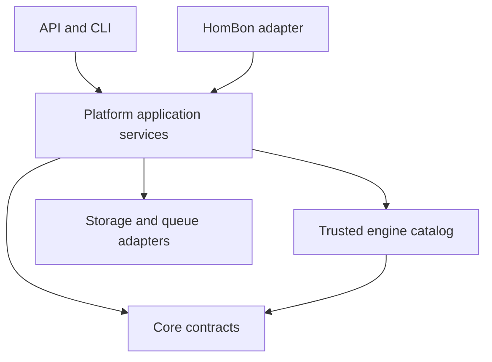

# Architecture

Status: accepted foundation, version 0.3.0. Implementation state is tracked in
[status.md](status.md); the architecture below includes future capabilities.

## Product and ownership

Peykar is the general-purpose biological simulation platform previously described
as UBSP. HomBon is a separate autonomous research system. Peykar is not HomBon's
research planner, literature agent, or hypothesis approval service.

The five capabilities are biological representation; a model ecosystem;
multiscale simulation; scientific data and validation; and controlled model
learning. Shared contracts connect them without making one engine the platform.

## Deployment and package architecture

Begin with a modular monolith and separately executed workers. The workspace has
three actual distributions, rather than one distribution per conceptual folder:

`peykar_core` cannot import `peykar` or `peykar_engines`. `peykar_engines` can only
depend on the core contracts. `peykar` composes these dependencies at its entrypoints.
The architecture test enforces the first two boundaries. Infrastructure is composed
inside application services for now; interfaces can be extracted when a second
storage implementation exists. No PostgreSQL adapter is claimed in this release.

Each platform domain owns a module under `packages/platform/src/peykar`. The
following table is the mapping from the original target folders to executable
modules or explicitly planned extension points.

| Domain | Responsibility | Current boundary |
|---|---|---|
| Core | Types, identifiers, units, contracts, hashes, errors | Independent distribution |
| Biology | Entities, ontologies, anatomy, interactions and unknowns | Species-aware reference graph; persistent declared knowledge gaps |
| Model registry | Packages, versions, capabilities and dependencies | Persistent exact-version registry |
| Model import | Discovery, inspection, mapping and sandbox admission | Declarative JSON inspector and offline digest-checked file admission; no external execution |
| Composition | Ports, semantics, ownership and numerical coupling | Compatibility/DAG checks and exchange primitive |
| Simulation | Planning, time, events, state and execution | Durable queue, bounded Linux child lifecycle and two reference engines |
| Interventions | Molecular through environmental changes | Parameter-set implementation; other classes planned |
| Data fabric | Ingestion, quality, lineage and observation | CSV and explicitly mapped scalar exports; raw/normalized lineage and shared import identity |
| Model learning | Calibration, refinement, construction and surrogates | Decay parameter candidate estimator |
| Validation | Verification, independent benchmarks and uncertainty | Endpoint comparison, frozen splits/seed protocols and retrievable reports; no quantified uncertainty |
| Governance | Provenance, permissions, approvals and promotion | API roles, event log, provenance export |

## Biological representation

An anatomical hierarchy is one view of an interaction graph. Molecules and pathways
can participate in several cells or tissues. `part_of` and `is_a` are individually
acyclic; regulatory networks can have feedback. Edges include species, biological
context and evidence references. Ontology identifiers should use stable external
namespaces (for example NCBI Taxonomy, UBERON, CL, GO and ChEBI).

No human-specific root is hard-coded. Molecular, cellular, tissue, organ,
organ-system, organism, population and environment are analysis scales, not an
assertion that every biological relationship is containment. Population/ecosystem
execution remains future work. KnowledgeGap records make missing mechanisms
explicit rather than filling them with model-generated guesses.
These local gap declarations are immutable, manually registered records. They do
not resolve scientific conflicts, certify evidence or automatically block jobs.

## Model ecosystem

A biological library is a reusable mechanism. A model package is an executable
model of a specified context. A composite pins model versions and the coupling
model versions that connect them. Changes create new versions, never overwrite a
published version. Dependencies are exact and resolvable at admission time.

Discover by scientific capability, species, endpoint and applicability. Choose
reuse, adaptation, composition, or construction based on evidence and integration
cost. Import must inspect licenses and dependencies before any executable code is
installed. The current API accepts descriptors only. It cannot fetch or execute a
user-supplied Python file, Git URL, pickle, model archive or shell command.

The engine catalog is an allowlist of trusted installed implementations. Optional
Python entry-point loading is an explicit operator action, never an API capability.
An entry point executes code and is not a sandbox.

## Composition and numerical contracts

Every scientific port declares quantity units, semantic identity, direction,
scale, shape and coordinate frame. A concentration cannot be connected to a mass
by dimensional coincidence; volume and observation mappings must be explicit.
Spatial transfers need geometry, coordinate transforms and conservative remapping.
One state variable has one owner; avoid counting the same proliferation, molecular
flux or metabolic sink in two connected models.

The current checker accepts a DAG with one writer per input. It rejects algebraic
feedback. It does not execute a DAG of engines or implement an implicit solver.
The exact two-compartment exchange function is a small, executable conservation
verification primitive, not general co-simulation.

Future coupled execution needs capability negotiation: advance-to time, snapshot,
restore, event localization, restart support, determinism and error reporting.
The master scheduler must handle communication steps, multi-rate updates,
interpolation, event ordering, convergence criteria and rollback. FMI informs this
design, but Peykar does not claim to implement FMI. Validate stability, conservation
and coupling error separately from biological accuracy.

## Simulation state and time

Scientific state belongs to a model instance and its engine, not to an LLM or a UI.
Management state belongs to the platform. Manifests are immutable; status is a
separate mutable state machine with append-only application events.

The reference scheduler uses seconds internally, regular output grids and explicit
parameter interventions aligned to grid boundaries. An event at time t applies to
the interval starting at t, after the state at t is reached. Changing an initial
state parameter during a run is rejected. General spatial state, adaptive solvers,
native checkpoints and ensemble execution are later engine capabilities.

## Data, learning and validation

Datasets carry origin, role, license, source, context, checksum and an independence
group. Calibration and held-out evaluation remain distinct. Related samples from
one donor, experiment or publication must not leak across a split.

An observation operator maps simulated variables to measured endpoints, time
sampling and measurement noise. The reference evaluator only accepts identical
time grids and unit-convertible scalar endpoints. It rejects unsupported mappings
instead of silently interpolating. Experimental origin and role are declared
metadata; their truth needs external review. Caller-supplied split groups are not
a complete governance system.

Calibration creates parameter proposals. Structural changes and model construction
create challenger versions. A future champion/challenger promotion service must
run frozen historical benchmarks, endpoint-specific held-out tests, sensitivity,
identifiability and uncertainty checks, with an evaluator independent of the model
author. It cannot let the candidate redefine its own success criteria.

The complete v3.0 design separates parameter, structural, measurement, biological,
coupling and extrapolation uncertainty, with numerical error additionally tracked
as an engineering concern. Disclose which sources are measured versus unknown.
This release does not calculate posterior confidence
intervals, sensitivity indices or cross-species transfer confidence.

## Infrastructure evolution

SQLite in WAL mode plus local content-addressed artifacts is the executable
single-host profile. PostgreSQL and S3-compatible object storage are the intended
multi-host profile. A shared network filesystem is not a substitute for a distributed
queue. Postgres transactions/leases and an outbox would replace local queue behavior.

Introduce a graph database only when measured query needs justify it. Add MLflow
for ML experiment tracking, not as a replacement for scientific provenance. Use
AnnData/SpatialData for cell/spatial data and Xarray/Zarr/OME-Zarr for large arrays
and images when their respective adapters exist. SLURM and cloud batch execution
belong behind execution adapters. No infrastructure is provisioned by this repo.

## User interface

The six planned workspaces are Biological Explorer, Model Studio, Dataset Studio,
Experiment Studio, Simulation Viewer and Validation Center. They share the API,
not engine internals. Viewer geometry and animation must distinguish computed
state from illustrative graphics. Showing a cell animation when only population
count was computed must be labeled illustrative. See `apps/dashboard/README.md`.

## External lifecycle

The HomBon facade exposes describe, validate, estimate_cost, submit, status,
collect and cancel. It returns structured results including origin and limitations.
The outer research system owns hypothesis selection and scientific interpretation.
Changing the outer research use case should not require a core engine change.

The [complete original proposal](blueprints/README.md) and its
[section/scenario coverage map](blueprint-v3-coverage.md) preserve further design
requirements. [The master blueprint](master-blueprint.md) includes the restored
ten intervention categories, five model interfaces, distinct entity/model/instance
identities, trust axes, claim/conflict registries and L0-L3 authority levels.
