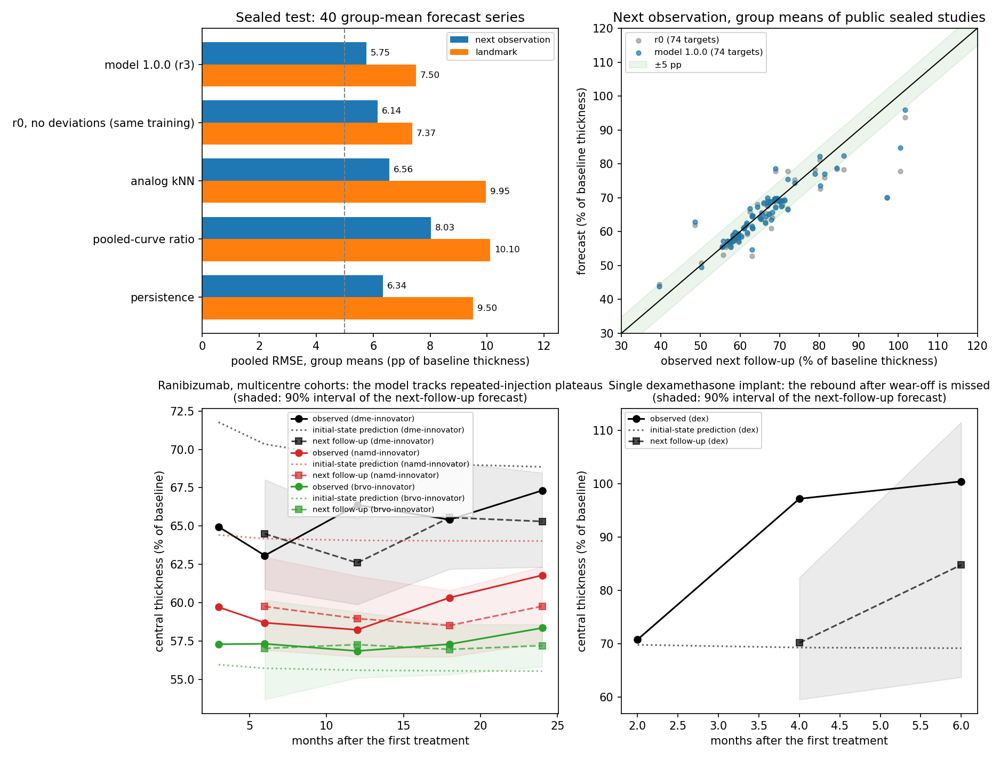

# Retinal-thickness model 1.0.0

Population model of central retinal thickness after treatment, as a fraction `f` of
each series' pretreatment value, over months `t`. It is the generic eye recovery
model (`peykar.model_learning.eye_recovery_population`) with the configuration
`r3` of `peykar.model_learning.retina_thickness_population`.

## Model

```
ln f(t) = ell + e r(t) + s q(t) + d(t) + noise
r(t) = exp(-(t - 1 day) / tau),  q(t) = exp(-(t - 1 day) / 14 days)
ell  = context level + b ln(CST0 / 300 um)
d    = Ornstein-Uhlenbeck deviation, 80% of the residual variance, correlation time 12 months
```

- **Law.** A slow return `e r(t)` toward the long-term level `ell` and a fixed
  14-day onset transient `s q(t)`; `ln tau` on an 80-point grid from 0.01 to 120
  months. The level regresses on the baseline thickness (thicker eyes fall further:
  regression toward a normal thickness), with one slope estimated inside REML.
- **Hierarchy.** One per species: species mean, context (`indication/treatment`),
  study and series (group means and single eyes separately), diagonal covariances by
  penalized REML. A context without training studies uses the species mean with the
  context variance added.
- **Persistent deviations.** Series stay above or below the smooth law for months
  (retreatment regimens, implant wear-off). Forecasts condition the target's
  deviation on the observed residuals exactly; the population itself is fitted
  under working independence, so initial-state predictions equal those without the
  deviation term.
- **Noise.** Gaussian in `ln f`, group-mean SD scaled by `(n/40)^-g`; a new study's
  SD is marginalized around the scaled median.
- **Forecasts.** Exact Gaussian mixtures over `tau`, noise levels and prior
  components; the point forecast is the posterior predictive median.

The generic module reproduces IOP model 1.1 when configured like it (fixed effects,
variance components, REML objective, priors and predictive quantiles agree to 1e-9
on synthetic data), and its deviation forecasts match the exact joint Gaussian
(`tests/unit/test_eye_recovery_population.py`).

## Development (46 development studies, leave-one-study-out)

See the [development log](development-log.md). Group means, pooled RMSE in
percentage points of the baseline thickness:

| task | model 1.0.0 (r3) | r0 (no deviations) | persistence | pooled curve | analog kNN |
|---|---|---|---|---|---|
| next observation (145 targets) | 8.23 | 8.76 | 8.67 | 9.86 | 10.20 |
| landmark from first follow-up (145) | 10.31 | 10.35 | 13.20 | 13.96 | 14.72 |
| initial state, controls (178) | 13.89 | 13.89 | — | 17.28 | — |

Next-observation interval coverage on group means: 73.8% (80%) and 83.4% (90%).

Known limits seen in development: steroid-implant rebound after the drug wears off
(3–4 months) and retreatment dips are not part of the law; single-eye intervals are
too narrow; most series have only 2–4 follow-ups. No result is a clinical claim.
The sealed test is defined by [protocol 1.0.0](protocol-1.0.0.json).

## Sealed test (one shot, 2026-10-28)

Protocol 1.0.0 (SHA-256 `64b0ad17…`, freeze commit `d40b6ed2`) was frozen before any
sealed value was read. The operator verified every pinned hash, fitted on the 46
development records (minus author-linked studies) and scored each of the 19 sealed
studies once with model 1.0.0 and, in the same run, with the reference r0 (146.6 s;
report SHA-256 `03917257…`, reference `0c3dabbc…`). Public, licence-redacted
artifacts are in [`sealed-test-2026-10-28/`](sealed-test-2026-10-28/tables.md)
(12 CC BY studies with values, 7 redacted to metrics only).

All five declared checks pass on group means (40 forecast series, 98 targets; 31
control groups, 112 targets for the initial state):

| check | model 1.0.0 | comparators |
|---|---|---|
| H1 next-observation coverage | 81.6% (80%), 91.8% (90%) | windows 0.70–0.90 and 0.80–0.97 |
| H2 next observation RMSE | **5.75 pp** | persistence 6.34, analog 6.56, pooled ratio 8.03, last two 17.08 |
| H3 landmark RMSE | **7.50 pp** | persistence 9.50, analog 9.95, pooled ratio 10.10 |
| H4 initial state RMSE | **11.35 pp** | pooled training curve 17.09 |
| H5 next observation vs r0 (same training) | **5.75 pp** | r0 6.14 |

Reported, not tested: landmark against r0 7.50 vs 7.37 pp (r0 slightly better);
initial state identical to r0 by construction; landmark coverage 83.7% / 90.8%;
initial-state coverage 88.4% / 92.9%; single eyes (20 targets) 4.61 vs persistence
5.31 pp.



Where the gain is and is not (private report, group means):

- Anti-VEGF contexts (56 of 98 next-observation targets) have RMSE 1.1–3.7 pp, below
  persistence in each indication.
- Outside steroid implants, the gain is in early follow-ups: from origins up to 3
  months 6.09 vs persistence 7.74 pp (44 targets); later 2.40 vs 2.37 pp (43
  targets, a tie).
- Steroid implants (11 targets) are worse than persistence (12.2 vs 11.9 pp early,
  10.2 vs 7.8 pp later): the rebound after a single dexamethasone implant wears off
  (`ret-pmc11921743`, 27 pp too low at month 4; `ret-pmc5685094`, uveitic edema) is
  not part of the law, as seen in development.
- Per series, 24/40 group means stay within 5/10 pp for the next observation, and
  only 5/40 also beat persistence by 0.5 pp; landmark 22/40 within (8/40 with the
  persistence gain); initial state 13/31 within.
- Initial state: the 27 control groups in contexts with development studies have
  10.25 pp; the 4 in contexts without any (DME observation arm, uveitic edema with a
  dexamethasone implant, central serous chorioretinopathy with anti-VEGF,
  postoperative edema with drops) fall back to the species mean and have 17.17 pp.
  The largest single error is the DME observation arm (33.2 pp); among trained
  contexts, one three-arm DME trial (`ret-pmc3151562`, 17.7–32.0 pp) and the
  wearing-off implant (24.2 pp).

**Variability floor.** The model's own estimate of visit-to-visit variability around
the smooth law (residual SD of best fits, seven development studies with five or
more follow-ups) is 8.2% of baseline for a group of 40 eyes, scaling as `n^-0.5`
(16% at 10 eyes, 5% at 100). It mixes disease activity under retreatment regimens
with law misfit; OCT repeatability itself is far smaller. With 80% of it treated as
persistent, the independent part alone is about 3.7% at 40 eyes and 7.3% at 10 eyes,
so the fixed per-series 5 pp RMSE criterion is near or below the floor for small
groups. This explains part, not all, of the low per-series pass counts.

The sealed set is now consumed. A later version (for example a drug wear-off term
for single implants) must be tested on the unread tranches 2–4 of the dataset.
