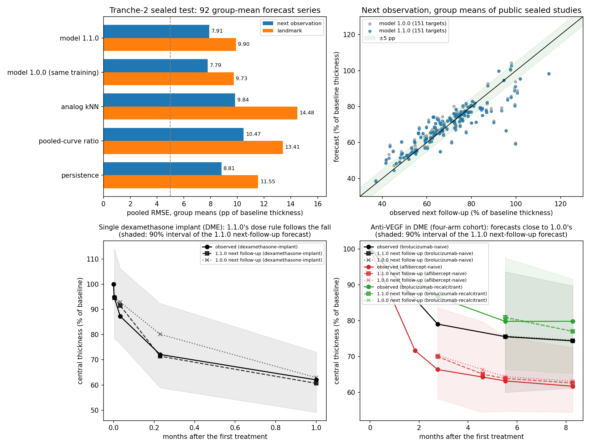

# Retinal-thickness model 1.1.0

Version 1.1 of the central-retinal-thickness model, tested once on a fresh sealed set
(tranche 2 of the dataset, reserved before triage). It targets the two failures of
the [1.0.0 sealed test](../model-1.0/README.md): the missed re-thickening after one
dexamethasone implant wears off, and contexts without training series.

## Model

Configuration `s5` of `peykar.model_learning.retina_thickness_population_1_1`, on the
generic eye model version 2 (`peykar.model_learning.eye_recovery_population2`; with
default options it reproduces generic model 1 bit for bit).

```
ln f(t) = L(t) (1 - rho W(t)) + d(t) + noise
L(t)    = model 1.0.0's law: ell + e r(t) + s q(t)
W(t)    = 1 / (1 + exp(-(t - D) / w))   for one dexamethasone implant, else 0
D = 3.5 months, w = 0.5 months, rho = 0.8 (declared dose rule)
```

- **Dose rule.** A group that received one dexamethasone implant (regimen `single`;
  treatment `steroid_implant` unless the agent is fluocinolone, or a combination whose
  agent names a dexamethasone implant) loses 80% of its treatment effect around month
  3.5. The constants come from the implant's known course and the training implant
  series, not from the sealed set. Fluocinolone implants and all other groups follow
  the 1.0.0 law.
- **Forecast noise.** Likelihoods and posteriors use 1.0.0's noise centre (the median
  of study residual SDs). Forecast intervals add independent noise so that their noise
  matches the pooled centre `sqrt(sum(dof sd^2) / sum(dof))` of the same fit. The
  median rested on a few estimates with one or two degrees of freedom and was too small.
- Everything else (hierarchy, persistent deviations in forecasting, exact Gaussian
  mixtures, predictive medians) is unchanged from 1.0.0.

## Development (65 tranche-1 studies, leave-one-study-out)

See the [development log](development-log.md). Three rounds, each declared before its
results. Adopted: the wear-off (s2) and the forecast-only pooled noise (s5). Not
adopted: a fallback from untrained contexts to the trained contexts of the same
treatment (s1, no gain) and the pooled noise in every likelihood (s4, point forecasts
0.10 pp worse). Group means, pooled RMSE in percentage points of the baseline:

| task | model 1.1.0 (s5) | model 1.0.0, same training | persistence |
|---|---|---|---|
| next observation (243 targets) | 6.37 | 7.29 | 7.82 |
| landmark from first follow-up (243) | 7.95 | 9.04 | 11.85 |
| initial state, controls (290) | 12.15 | 13.28 | — (pooled curve 17.35) |

Next-observation coverage 84.8% (80%) and 93.0% (90%). The implant gains in
development are optimistic: the dose rule was set with the training implant series in
view. Public, licence-redacted development artifacts:
[`development-loso-2026-10-28/`](development-loso-2026-10-28/tables.md).

## Sealed test (one shot, 2026-10-28/29)

[Protocol 1.1.0](protocol-1.1.0.json) (SHA-256 `fd14a1c5…`, freeze commit `84ee1e9c`)
was frozen before any tranche-2 value was read. The operator verified every pinned
hash (53 files, 65 training and 63 sealed records), fitted on the 65 training records
(minus author-linked studies) and scored each of the 63 sealed studies once with model
1.1.0 and, in the same run, with the frozen model 1.0.0 (2,381.9 s; report SHA-256
`00554481…`, reference `85cb7cbb…`). Public, licence-redacted artifacts are in
[`sealed-test-2026-10-28/`](sealed-test-2026-10-28/tables.md) (34 CC BY studies with
values, 29 redacted to metrics only).

Group means: 92 forecast series with 250 targets; 74 control groups with 275 targets
for the initial state.

| check | model 1.1.0 | comparators | verdict |
|---|---|---|---|
| H1 next-observation coverage | 84.4% (80%), 89.6% (90%) | windows 0.70–0.90 and 0.80–0.97 | pass |
| H2 next observation RMSE | 7.91 pp | persistence 8.81, analog 9.84, pooled ratio 10.47, last two 26.40 | pass |
| H3 landmark RMSE | 9.90 pp | persistence 11.55, pooled ratio 13.41, analog 14.48 | pass |
| H4 initial state RMSE | 13.00 pp | pooled training curve 18.51 | pass |
| H5 against model 1.0.0, same training, all three tasks | next 7.91, landmark 9.90, initial 13.00 | 1.0.0: 7.79, 9.73, 13.25 | **fail** |



**What generalized.** The forecast noise fix held on fresh data. Model 1.0.0's
intervals covered only 66.0% (80%) and 77.2% (90%) of the sealed next observations, so
1.0.0 would have failed H1 here; 1.1.0's covered 84.4% and 89.6%. Landmark coverage
rose from 62.0% / 70.4% to 74.4% / 80.4%. The dose rule improved the initial state of
the four sealed single-implant control group means from 14.61 to 5.42 pp (12
targets).

**What did not.** Point forecasts were slightly worse than 1.0.0's (by 0.12 pp for the
next observation and 0.17 pp for the landmark), so the declared H5 fails. The largest
part comes from one study (`ret-pmc6899066`): after vitrectomy with a dexamethasone
implant, the dose rule predicted a rise after month 3 (0.88 of baseline at month 6)
that did not happen (0.61). Post hoc only, not a test: without that study's 4
targets, 1.1.0 would have been lower than 1.0.0 in both forecast tasks (7.75 vs 7.85
and 9.74 vs 9.80 pp). Five sealed group means fall under the dose rule. For four of
them, 1.1.0's next-observation forecasts were closer than 1.0.0's (RMSE 2.25 vs 4.91,
4.96 vs 7.10, 10.11 vs 17.37 and 11.80 vs 17.56 pp); for the vitrectomy group they were
far worse (20.35 vs 2.37 pp), so the pooled error over the 10 targets was higher (10.67
vs 9.05 pp).

Other findings (private reports, group means):

- Anti-VEGF groups (93 next-observation targets): 5.77 vs 1.0.0 5.80 and persistence
  7.15 pp.
- Implant groups outside the dose rule (fluocinolone, repeated dexamethasone; 30
  targets): 11.27 vs 11.34 and persistence 13.57 pp.
- Contexts without training series (23 targets): 11.27 vs 10.94 pp, worse than
  persistence (10.21); initial state 20.87 vs 21.35 pp. This failure of 1.0.0 remains.
- Per series: 47/92 group means within 5/10 pp for the next observation (26 also beat
  persistence by 0.5 pp); landmark 38/92 (28); initial state 11/74.
- Single eyes (reported, 96 targets): 13.28 vs 1.0.0 12.84 pp for the next observation.

**Conclusion.** The calibration change is kept as a lesson for every component: the
median of a few small-sample residual SDs underestimates the noise. A fixed effect
duration for every single implant is too rigid; a next version should let the duration
vary per series and learn it from each series' own visits. Contexts without training
series need more data rather than a fallback rule. The sealed set is now consumed;
tranches 3–4 of the dataset (155 articles) stay unread for the next version. No result
is a clinical claim.

Persian summary: [results.fa.md](results.fa.md).
