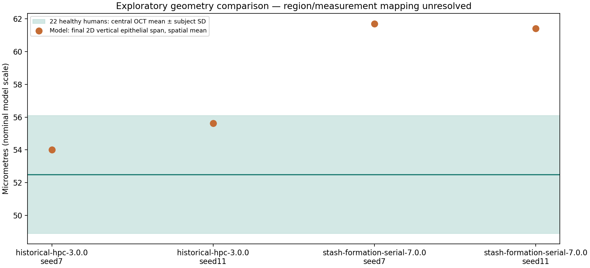

# Experimental corneal comparison: usable data and explicit observation limits

The [acquired datasets and sample inspection](../../data/cornea-evidence-20261024/README.md)
now provide real human experimental aggregates, original rabbit wound observations
and inspected Hugging Face samples. Existing publication-reproduction criteria,
source families, failed runs and biological parameters are unchanged.

## Implemented offline path

`peykar.validation.cornea_evidence` parses the actual inert source workbooks/XML,
normalizes within-rabbit measured wound fractions, recovers the clinical Normal
group and measures physical geometry from actual lattice cell types. It never
imports an upstream script, evaluates a spreadsheet formula or fetches data.

The new `cornea.vertical-epithelial-span-1.0.0` operator identifies epithelial
types1/3/4/5 in each x-column and reports:

- inclusive vertical span `(last_y - first_y + 1) × nominal µm/site`;
- occupied height and internal non-epithelial gaps, separately;
- columns without epithelial sites as null spans, not invented zero-thickness data;
- spatial mean and populationSD, explicitly not independent-subject statistics.

Shifting the complete tissue in y does not change thickness. This avoids treating
the old top-cell yCOM export as physical thickness. It still is a2D vertical
operator with nominal scale, not a calibrated OCT-normal optical measurement.
No central/limbal anatomical mapping for the400µm model domain is invented.

The explicit command reads only **verified completed** native records, full final
arrays, original experimental files and the declared diagnostic plan:

```bash
PYTHONPATH="$PWD/packages/platform/src:$PWD/packages/core/src" \
  .peykar/cornea-native46/bin/python scripts/compare_corneal_evidence.py \
  --evidence experiments/data/cornea-evidence-20261024 \
  --protocol experiments/data/cornea-evidence-20261024/diagnostic-plan-1.0.0.json \
  --runs .peykar/cornea-historical-formation46-20261023 \
  --runs .peykar/cornea-stash-serial-formation46-20261024 \
  --output .peykar/cornea-experimental-diagnostic-retry1-20261024
```

Use a fresh output directory on another invocation. No native simulation is
launched; no installed scientific package, live data volume or schedule changes.
Initial invocation found a management-only Pydantic import unavailable in the
frozen native runtime. The observation module/operator now use standard-library
SHA-256 instead; no packages were added to that immutable scientific environment.

## Actual comparison, without an invented accuracy percentage

The clinical Normal group contains22human subjects: central epithelial thickness
52.5±3.6µm. Four already completed full180-day model outputs give:

| Source/profile | Seed | Mean vertical epithelial span | Descriptive difference from clinical mean |
|---|---:|---:|---:|
| July historical3 | 7 |54.01010µm|+1.51010µm|
| July historical3 | 11 |55.62626µm|+3.12626µm|
| January serial7 | 7 |61.68687µm|+9.18687µm|
| January serial7 | 11 |61.40404µm|+8.90404µm|

Each row is one model realization; its198occupied spatial columns are not198
subjects. Both complete formation series are included, including the publication
candidate that failed. No successful subset was selected to produce this chart.

The report flags unresolved **measurement** and **region** mappings. Human
central OCT versus the whole model cross-section has no validated observation
equivalence. Calibration independence is not proven by absence of a citation.
These differences are descriptive quantities, not paired errors/RMSE, a clinical
accuracy score or an independent biological pass. `passed` remains null and
`independent_biological_validation` false, including for numerically close values.

Retained [actual report](observed-2026-10-24/report.json),
[Hugging Face sample/QC receipt](observed-2026-10-24/hf-actual-sample-qc.json)
and [exact diagnostic plan](observed-2026-10-24/diagnostic-plan.json) allow inspection.



The rabbit data are useful for a future matched debridement protocol, but their
species, mechanical injury, PBS/silk exposure,7mm en-face defect area and
fluorescein measurement differ from the chemical model's2D basal-exposure proxy.
The current comparison records every mismatch; it does not convert a2D open-width
or count-return proxy into a clinical wound-area score.

## Next scientific work supported by these retained data

1. Establish a homologous model region and validate the thickness observation
   against acquisition geometry before freezing independent human acceptance.
2. Preserve the original rabbit3-versus-caption4 discrepancy. Recover measurement
   units and exact subject context before selecting a new matched mechanical
   debridement model/version; keep PBS controls separate from silk interventions.
3. Keep chemical-specific dose/transport mapping open. Porcine mechlorethamine,
   rabbit debridement and human clinical summaries do not establish it.
4. Admit additional datasets with exact versions/raw hashes, endpoint/units,
   subject hierarchy and calibration-use review. Unknown context is a blocker;
   downloading more rows alone does not close biological validation.

The original [publication reproduction](../publication/README.md) remains a
separate unresolved gate. This work advances corneal empirical observation and
data availability; it starts no unrelated model or scheduled automation.
