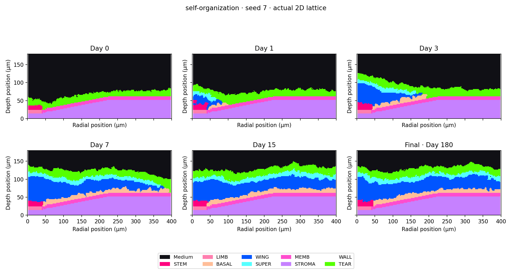

# نتیجهٔ بررسی اجراهای قرنیه — ۲۴ اکتبر ۲۰۲۶

هر چهار اجرای باقی‌مانده تمام شدند؛ هیچ‌کدام وسط کار قطع نشدند.
دو اجرای تشکیل بافت تا روز ۱۸۰ و دو اجرای آسیب تا روز ۲۱۰ جلو رفتند.
برای آسیب، روز ۳۰ ماده اعمال می‌شود و بعد از آن ۱۸۰ روز دنبال می‌شود.
تحلیل‌ها هم تمام شده‌اند؛ اکنون شبیه‌سازی فعالی باقی نمانده است.

**بازسازی کامل نتیجهٔ مقاله هنوز تأیید نشده است.**

## چه چیزی واقعاً کار می‌کند؟

- اجرای واقعی مدل، ذخیرهٔ تعداد سلول‌ها و ضخامت، و بررسی خروجی تا آخر زمان تعیین‌شده.
- ذخیرهٔ شکل واقعی بافت و میدان عامل رشد؛ تصویرها فقط از شمارش سلول‌ها ساخته نشده‌اند.
- اجرای روش محاسبهٔ اصلی نویسندگان روی داده‌های جدید و مقایسه با داده‌های منتشرشده.
- بررسی اینکه حجم ثبت‌شدهٔ سلول‌ها با خانه‌های اشغال‌شده در شبکه برابر باشد.
  خروجی‌های جدید این بررسی را گذرانده‌اند؛ خروجی ناسازگار قبلی حفظ و رد شده است.
- بررسی مقدار و محل واقعی مادهٔ آسیب‌زا و تمام ۵۰٬۴۰۱ نمونهٔ زمانی هر اجرای آسیب جدید.
- نگه‌داشتن گزارش خروج واقعی برنامه و چک‌سام فایل‌ها، همراه با خطاهای قبلی.

## نتیجهٔ مقایسه چه شد؟

شش اجرای آسیب که قبلاً تمام شده بودند دوباره اجرا نشدند؛ همان خروجی‌های بررسی‌شده
با دو اجرای جدید تشکیل بافت، یک مقایسهٔ کامل هشت‌تایی ساختند:

| حالت | نتیجهٔ مقایسه با مرجع مقاله |
|---|---|
| تشکیل بافت، دو تکرار | هر دو رد شدند؛ تعداد برخی سلول‌ها و ضخامت اختلاف دارد |
| آسیب با دوز ۷۵۰، دو تکرار | هر دو رد شدند؛ بعضی تعدادها یا ضخامت‌ها اختلاف دارند |
| آسیب با دوز ۱۵۰۰، دو تکرار | یکی همهٔ معیارهای عددی را گذراند، دیگری رد شد |
| آسیب با دوز ۲۵۰۰، دو تکرار | هر دو همهٔ معیارهای عددی را گذراندند |

پس از هشت اجرا، **سه نتیجه همهٔ معیارهای عددی را گذرانده‌اند و پنج نتیجه رد شده‌اند**.
دو اجرای جداگانهٔ آسیب با نسخهٔ قدیمی‌تر هم تا آخر تمام شدند؛ میانگین تعداد سلول‌ها
و ضخامت را گذراندند، ولی تغییر تعداد یک نوع سلول در طول زمان با مرجع کافی تطبیق نداشت.
این دو نتیجه هم رد شده‌اند. دو اجرای قدیمیِ تشکیل بافت که قبلاً معیارها را گذرانده
بودند همچنان حفظ شده‌اند؛ نتیجه‌های خوب و بد از نسخه‌های مختلف با هم انتخاب نشده‌اند
تا ظاهراً یک بازسازی موفق ساخته شود.

شکل بافت هم مهم است: در یکی از اجراهای جداگانهٔ آسیب، بخشی از سلول‌ها پایین‌تر
از مرز اولیهٔ بافت قرار گرفته‌اند. بنابراین حتی اگر تعداد سلول‌ها قابل قبول باشد
یا مسیر باز از سطح به عمق دیده نشود، هنوز نمی‌توان گفت بافت درست ترمیم شده است.
این مشاهده با دادهٔ واقعی ثبت شده و به اسم نتیجهٔ زیستی موفق گزارش نشده است.

برای یک مثال روشن، در تشکیل بافت جدید، میانگین یک نوع سلول حدود ۱۷۱ و ۱۷۴ است،
ولی میانگین مرجع حدود ۱۴۳ است. این اختلاف را نمی‌شود با تمام‌شدن برنامه، گذشتن
تست نرم‌افزار یا عوض‌کردن حد قبولی حل‌شده حساب کرد.

## چه چیزی برای تمام‌شدن کار کم است؟

سورس‌ها، نسخه‌های قدیمی، داده‌ها و روش تحلیل بررسی شده‌اند، اما هنوز مشخص نیست
هر گروه دادهٔ مقاله دقیقاً با کدام تنظیمات نهایی، حالت اولیه، وضعیت تصادفی و
ساخت موتور تولید شده است. [فهرست دقیق فایل‌ها و اطلاعات لازم](original-run-metadata-needed.md)
در پروژه ثبت شده است. برای ادامهٔ بازسازیِ دقیق باید آن اطلاعات اصلی بازیابی شود؛
تنظیمات حدسی را به اسم تنظیمات اصلی ثبت نمی‌کنیم.

بنابراین الان ابزار اجرا و تحلیل و خروجی قابل بررسی داریم، ولی مدل را بازسازی کامل
مقاله یا مدل زیستیِ اعتبارسنجی‌شده معرفی نمی‌کنیم. داده‌ها و مجوزها حفظ شده‌اند؛
زمان‌بندی خودکار همچنان متوقف است و کار مدل دیگری شروع نشده است.

[گزارش عددی و رسیدهای کامل](serial-final-results-2026-10-24.md)

