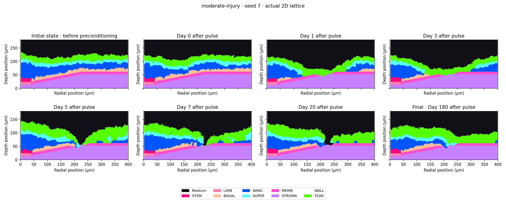

# Terminal serial corneal results, 2026-10-24

All four outstanding native jobs completed their declared full horizons with real
child exit0. Both bounded analysis follow-ons finished. No native simulation is
still active at the08:00UTC inspection. The existing API/Worker remain healthy;
the live data volume and paused recurring schedule were not changed.

**The publication reproduction is not complete.** The full January candidate is
`not_reproduced`; the separate July injury derivative is
`diagnostic_not_reproduced`. Original mathematics and spatial analyses completed
exit0 for both. Native completion, saved-state consistency, reference agreement
and independent biological validation are separate conclusions.

## Actual native completion

| Declared profile | Case/seeds | Horizon | Observed elapsed seconds |
|---|---|---|---|
| observed-injury-serial-6.0.0 | Moderate7/11 | 50400MCS /5040h | 10715.82 /11179.29 |
| stash-formation-serial-7.0.0 | Formation7/11 | 43200MCS /4320h | 8933.22 /8964.58 |

These are explicit one-worker execution derivatives. Their biological controls,
original states, source identities and frozen comparison remain as prepared.
The new January full comparison reuses the six previously verified one-worker
January injury completions; it does not launch another six simulations. Every
reused injury comparison row is exactly equal to its previous diagnostic row.

The executed [retention operator](observed-2026-10-24/serial-terminal-retention-operator.py.txt)
rechecked all ten admitted jobs: exact source/driver/runtime/protocol identities,
actual completion guard exits and every recorded output hash. It also checked all
analysis-stage inventories before copying reports, figures and mean CSVs byte for
byte. Raw arrays and all failed attempts stay in their original private directories.

## Unchanged quantitative acceptance

| Candidate / case | Seed | Stable means | Hourly trajectories | Thickness bins | All scalar criteria |
|---|---:|---:|---:|---:|---|
| January serial formation | 7 | 1/4 | 3/4 | 1/10 | Fail |
| January serial formation | 11 | 2/4 | 3/4 | 1/10 | Fail |
| January slight injury, reused | 7 | 3/4 | 4/4 | 7/10 | Fail |
| January slight injury, reused | 11 | 4/4 | 4/4 | 9/10 | Fail |
| January mild injury, reused | 7 | 3/4 | 4/4 | 10/10 | Fail |
| January mild injury, reused | 11 | 4/4 | 4/4 | 10/10 | Pass |
| January moderate injury, reused | 7 | 4/4 | 4/4 | 10/10 | Pass |
| January moderate injury, reused | 11 | 4/4 | 4/4 | 10/10 | Pass |
| Separate July serial moderate diagnostic | 7 | 4/4 | 3/4 | 10/10 | Fail |
| Separate July serial moderate diagnostic | 11 | 4/4 | 3/4 | 10/10 | Fail |

The complete January result remains five failures and three scalar passes across
all four groups. Its formation Wing stable means170.75007/173.69589 differ from
the original143.30549 by27.44457/30.39040 cells; the frozen allowance is3.51668.
The two July serial moderate trajectories fail Wing hourly coverage:
0.8992263439793692 /0.8893076770482047, below the unchanged0.90 requirement.
Neither is rounded into a pass. Their mean and thickness passes cannot override
that trajectory failure. No candidate, seed or failed endpoint is discarded.

The separate previously completed July formation pair still passes its formation
subset. Combining it selectively with successful injuries from another source
family would not establish exact original-run correspondence or close this gate.

## Actual saved tissue and chemical outputs

All saved frames admitted to these two analyses passed exact type-summed native
volume/lattice occupancy checks, observer/count agreement and finite200×90 field
checks. The new January serial formation frames have no detected recurrence of
the old four-worker final tear mismatch. This is an observation about these saved
frames, not proof of the earlier corruption's cause or universal native stability.
The original inconsistent four-worker outputs and negative comparisons remain.

Each new injury trace contains50401 finite, nonnegative samples on the original
0.1h grid through5040h. The actual7200MCS/720h pulse is2500 at[100,75] in each
run. Both earlier interim pulse SHA-256s match their subsequently verified native
completion outputs. See [full chemical checks](observed-2026-10-24/serial-derived6-moderate-full-chemical.json)
with the [executed audit](observed-2026-10-24/serial-derived6-full-chemical-audit.py.txt)
and [pulse continuity](observed-2026-10-24/serial-derived6-moderate-pulse-continuity.json).

Actual final180-day formation/recovery structures, EGF fields and original count
plots were inspected. The July serial moderate7 final structural proxy still has
78/198 original basement columns exposed to top-connected fluid, whereas11 has
zero. These are descriptive2D model observations, not clinical wound closure.
In particular, passing aggregate means does not establish equivalent tissue repair.

The final moderate11 image also shows epithelial redistribution below the
original basement region. A separate read-only, non-preregistered
[fixed-initial-surface audit](observed-2026-10-24/serial-derived6-fixed-initial-surface.json)
quantifies this without adding acceptance criteria: initial and pulse Wing sites
below the original upper limb/membrane surface are zero in both seeds. At final
time they are45/1333 Wing sites in7 and3150/5194 in11, over12/176 of the198
eligible columns. The denominator is Wing sites in those eligible columns.
This fixed reference does not follow a moving membrane or diagnose invasion.
It does show why zero fluid-access columns cannot establish normal layer
organization or repair. The [executed operator](observed-2026-10-24/serial-derived6-fixed-initial-surface-audit.py.txt)
retains exact snapshot hashes and its limitations; no model/output was modified.

- [Full January receipt and verified job records](observed-2026-10-24/serial-january7-full8-native-and-analysis.json)
- [Full January quantitative comparison](observed-2026-10-24/serial-january7-full8-comparison.json)
  and [readable table](observed-2026-10-24/serial-january7-full8-comparison.md)
- [Full January spatial observations](observed-2026-10-24/serial-january7-full8-spatial.json)
- [Separate July moderate receipt](observed-2026-10-24/serial-derived6-moderate-native-and-analysis.json)
  and [quantitative comparison](observed-2026-10-24/serial-derived6-moderate-comparison.json)
- [Machine-readable terminal matrix](observed-2026-10-24/serial-terminal-result-matrix.json)

## What is usable, and what blocks the requested milestone

The pinned offline execution, real full-horizon output, original analysis,
quantitative rejection and actual structure/chemical inspection are usable for
research and further audited reconstruction. They do not support a claim that
the complete publication or independent biological experiments were reproduced.

Both original releases and the retained history have already been investigated.
The selected published output groups are still not linked to their exact expanded
run configuration, initial/checkpoint state, seeds/RNG states and native build.
The [concrete missing-input inventory](original-run-metadata-needed.md) identifies
the four original groups and evidence needed. New guessed parameters, hidden
fitting, rerunning unchanged inputs or relaxing the frozen criteria would not
resolve that evidence gap. No author or other person has been contacted.

No new managed code was needed to admit these actual completions. The unchanged
current implementation already passed541 regression tests, strict type checks,
18 frontend tests, contract checks and package builds in the preceding verified
milestone. This increment retains results and updates the truthful inventory;
it does not rerun the whole suite or begin another model. Scheduling remains paused.
