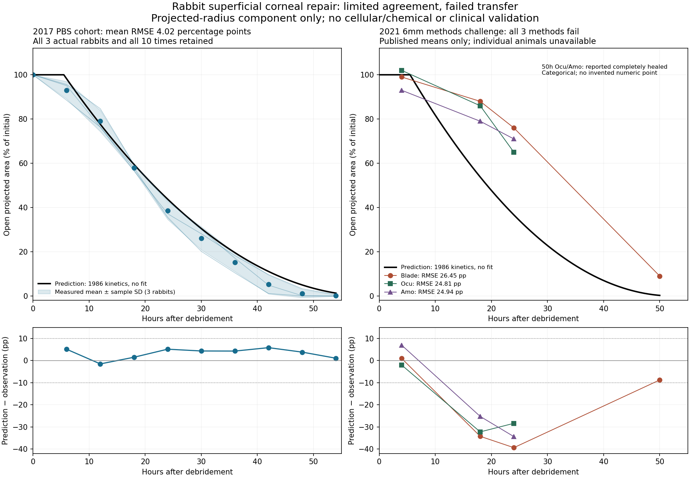

# Rabbit superficial repair: independent-parameter predictive check

This is a separately identified corneal **projected wound-front kinematics**
component. It supplies a matched experimental endpoint that the400µm limbal
vCornea slice cannot represent for a7mm whole-surface defect. It does not replace
that cellular model, simulate chemical injury or validate its cell-layer dynamics.

## Biological and observation basis selected before candidate execution

Crosson CE, Klyce SD and Beuerman RW (1986), *Epithelial wound closure in the
rabbit cornea. A biphasic process*, IOVS27:464–473,
[PMID3957565](https://pubmed.ncbi.nlm.nih.gov/3957565/), reports mechanically
removed epithelium with basal lamina intact: a5.5h latent phase followed by a
64µm/h decrease in wound radius. These are published point values, not fitted
using the2017 validation cohort. The reported±0.3h/±2µm/h have an unresolved
uncertainty definition in the inspected abstract and are not converted into CIs.
The full publisher article returned403; only the actual abstract/metadata was
inspected. Parameter facts and source identity are retained, without redistributing
an unlicensed full article or inventing missing experimental methods.

The projected-radius law is:

`r(t) = max(0, r0 - v × max(0, t - lag))`

For an approximately circular en-face defect, its projected area fraction is
`a(t) = (r(t)/r0)^2`. This is a geometric observation operator; width itself is
not called area. The model represents net radius motion, not cell proliferation,
barrier integrity, stromal remodeling, a curved surface area or a drug response.
The planar projection assumption follows the measured-radius description; no
unreported animal-specific curvature or physical image calibration is invented.

Abdel-Naby et al.2017 [PLOS ONE e0188154](https://doi.org/10.1371/journal.pone.0188154)
provides the separate experimental test:7mm nominal mechanical epithelial
debridement, PBS vehicle plus topical moxifloxacin. Thus r0=3500µm is its reported
initial-condition input. Original normalized wound fractions are computed only
from each rabbit's actual initial image area. The three measured Control rabbits
and every available0–54h observation are retained; silk-treated groups do not
share this exposure and are outside this candidate's scope.

## Frozen accuracy target

The [protocol1.0.0](protocol-1.0.0.json) is written before this new candidate's
first execution. Its primary endpoint is the **cohort mean normalized open area**
at all nine nonbaseline times6,12,…,54h. Baseline equality cannot lower its RMSE.
The engineering target is RMSE≤0.05 and maximum absolute error≤0.10 in area
fraction. These are declared small-error targets, not published clinical
equivalence margins or confidence intervals. Per-rabbit errors must also be
reported; a cohort-mean pass cannot be relabeled an individual-animal guarantee.

No parameter is fitted to the2017 data, no failing time/animal is removed and no
criteria change follows candidate results. The raw2017 data were already inspected
in the earlier dataset-admission work: this is a retrospective external-study
predictive check, not a preregistered clinical trial or a blinded dataset claim.
The n3-versus-caption-n4 discrepancy remains; absent animals are not reconstructed.

Important context limits remain explicit: the1986 abstract does not recover all
its treatment/supportive-care methods;2017 basement-lamina preservation is not
independently histologically verified by this work. This check can quantify
agreement of a narrowly scoped kinetic prediction, not establish universal
biological/clinical validity or claim exact experimental protocol identity.

The engine must be registered only by an explicit reviewed offline operator;
it is not added to the default API/Worker catalog. All existing licenses, model
versions, chemical runs, frozen publication comparison and datasets remain.

## Actual executions and comparison

Both explicit offline child processes completed with actual exit0 under the60s
wall limit; macOS Seatbelt denied network and writes outside the fresh run folder.
The2017 child took0.3353s; the2021 child took0.3240s. These are lightweight kinetic
simulations, not the earlier multi-hour cellular runs. No background job is active.

| Experimental endpoint | Nonbaseline mean RMSE | Maximum absolute error | Frozen result |
|---|---:|---:|---|
| 2017 PBS, mean of all3 actual rabbits,6–54h |4.0217 percentage points|5.8627 points|Pass5/10-point engineering targets|
| 2021 Blade,4/18/24/50h published means |26.4461 points|39.3572 points|Fail|
| 2021 Ocu,4/18/24h published means |24.8086 points|32.2222 points|Fail|
| 2021 Amo,4/18/24h published means |24.9371 points|34.3572 points|Fail|

Every available declared observation is retained. In2021, Ocu/Amo50h entries are
**categorical “Completely Healed”**, without a numeric residual or detection limit;
these remain in the report and are not replaced with invented measured zeros.
The numerical targets apply to every numeric point in each group, and **all**
groups must pass the challenge. The component's predicted time to zero for this
new6mm initial diameter is52.375h. No criterion, lag or speed was changed after
seeing candidate results. The2021 candidate predicts substantially faster early
repair than the measurements; it fails even with published rounding uncertainty.

The2017 individual-animal RMSE/max errors are also material:

| Actual rabbit ID | RMSE | Maximum error |
|---|---:|---:|
|1|4.2219 points|9.7107 points|
|2|6.6465 points|10.3143 points|
|3|3.7535 points|7.0442 points|

Thus the first result supports only a small-error **cohort-mean** prediction for
that recorded assay. It does not establish5-point accuracy for every rabbit, let
alone other species, injuries, substrate states or treatments. It is not a96%
“biological accuracy” score. Both model packages retain their original unvalidated
status; scientific evidence is appended here rather than overwriting model1.0.0.



The [PDF figure](observed-2026-10-24/experimental-prediction.pdf),
[2017 actual report](observed-2026-10-24/pbs2017/report.json) and
[2021 actual report](observed-2026-10-24/challenge2021/report.json) are portable.
All original candidates, plans, exact frozen protocols, observed process exits
and executed operator snapshots are retained alongside them. Full private runs
remain under `.peykar/cornea-repair-front-cross-study-retry1-20261024` and
`.peykar/cornea-repair-front-independent-challenge-20261024`. The earlier failed
setup is preserved: JSON text was incorrectly passed to a byte writer, before
any child/candidate started; it was corrected before the actual successful run.

The2021 [challenge protocol1.0.1](challenge-protocol-1.0.1.json) supersedes the
unexecuted1.0.0 only to pin pre-execution formatting/type-annotation corrections
in the parser. Parameters, observations and criteria did not change. Both frozen
files and the revision reason remain. The live operators now add artifact/exit/
protocol/grid/seed checks; [retained executed versions](observed-2026-10-24/)
identify the code that actually ran, and read-only regression tests verify the
same numbers without rerunning or fitting candidates.

## Second-study source and interpretation

Chung HS, Moon SH, Kang S-S, Kim M, Lee H, Tchah H and Kim JY (2021),
*Corneal Epithelial Removal with a Newly Designed Epithelial Brush*,
[Journal of Ophthalmology4668056](https://doi.org/10.1155/2021/4668056),
[PMC8828349](https://pmc.ncbi.nlm.nih.gov/articles/PMC8828349/), reports approximately
6mm mechanical defects in New Zealand white rabbits2.5–3.0kg. Blade defects were
washed with normal saline; PBS/moxifloxacin equivalence to2017 is not declared.
Blade edges were irregular, Amo defects often oval, and substrate/inflammatory
findings differed by removal method. This is an **applicability challenge**, not
an assertion of identical protocols or an inferred causal explanation of failure.

The exact [publisher-deposited XML](chung2021-manuscript.xml) was retrieved from
Europe PMC, preserving copyright©2021 Ho Seok Chung et al. and the original
Creative Commons Attribution license statement; the deposited statement does not
specify its license version. Table1 is parsed inertly, with all10 numeric means/
reported± values and both categorical50h statements. [Normalized observations](chung2021-observations.json)
retain1.02 at4h rather than clamping it. The± definition is unresolved, not
silently called SD/SEM or converted to a confidence interval. Methods state12
rabbits/24eyes per group with sacrifices at0/24/50h; no per-time sample sizes,
paired IDs or missing individual measurements are fabricated. Raw data are stated
available from the corresponding author upon request; no author was contacted.

The1986 source reports wound-radius motion; interpreting that radius as the
planar radius for fluorescein projection is an explicit geometric assumption of
this component, not an independently measured3D curvature correction. The old
vCornea article describes a400µm **limbal/peripheral radial sagittal slice**,
not the7mm central en-face domain. A whole-slice average cannot be renamed central
human OCT thickness. These observation limits remain open in the other benchmark.

## Reviewed offline use

From the repository root, after reviewing the pinned models and protocols:

```bash
uv run --frozen python scripts/check_corneal_repair_front.py \
  --output .peykar/cornea-repair-front-pbs-new-run
uv run --frozen python scripts/check_corneal_repair_challenge.py \
  --output .peykar/cornea-repair-front-challenge-new-run
```

Use fresh output directories. An actual child failure returns1; a completed
scientific comparison outside its frozen targets returns2. Passing the specific
comparison returns0; it never grants global biological validity. Both commands
pin source/input hashes, prohibit fitting, preserve actual execution records and
write full comparisons only after a successful child. The challenge's normal
observed comparison exit is2, despite its actual child execution exit0.

The engine is packaged for explicit offline registration only. No remote code is
installed, neither candidate is in the default API/Worker catalog, and existing
vCornea/native models, data volumes, licenses and paused scheduling remain.

## Next corneal improvement gate

Retain the2021 failure as a mandatory challenge for future variants. Before
fitting, acquire separately evidenced substrate/edge geometry, injury/care and
migration-phase measurements and identify **new** study-level test data. Four
rounded timepoint means cannot uniquely identify an inflammatory delay, changing
migration rate, wound curvature or substrate mechanism. Fitting them and calling
them untouched validation would not resolve the gap. Original full publication
reproduction and cellular/chemical experimental validation are still open.
