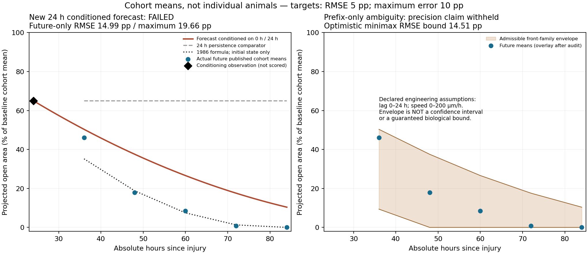

# Corneal forecast conditioned on a real24h observation

The latest user instruction permits another eye component only when the current
part has a useful accepted scope. Existing independent corneal failures remain
material, so this increment stays on cornea. It tests a concrete, distinct task:
**given measured wound area at injury and24h, forecast the later projected area**.
It is not a simulation using the initial injury alone, a new cellular mechanism
or a claim that the previous failed models have become valid.

## One method selected before future-value evaluation

[Design selection](design-selection-before-evaluation.json) and
[protocol1.0.0](protocol-1.0.0.json), SHA256
`2c8d7f806b01a440c5af4831d7b67d7386301436b5e89e4c73cc37c2124c72cd`,
predate candidate execution and parent-side future evaluation. There is one fixed
method, no lag estimation, model search, changed observation window or future
assimilation:

```
R0 = sqrt(A0/pi); R24 = sqrt(A24/pi)
v_effective = (R0 - R24)/24
R(24 + dt) = max(0, R24 - v_effective*dt)
A_forecast = pi*R^2; q_forecast = A_forecast/A0
```

Areas are reported mm², radii are equivalent circular mm and time is hours.
The radius of a cohort mean area is not the mean of individual radii. The speed
is an effective0–24h average, **not a measured instantaneous cellular velocity**.
The observed prefix is A0=72.32mm², A24=47.02mm²; it implies38.7176µm/h. No
intervention efficacy, latent biological cause or statistical uncertainty is inferred.

The original2019 source is
[Suárez-Barrio et al., DOI10.3390/ijms20071655](https://pmc.ncbi.nlm.nih.gov/articles/PMC6480555/).
[Original XML](ijms2019-original.xml), [PDF](ijms2019-original.pdf), NCBI version
metadata and [CC BY4.0 attribution/acquisition](ijms2019-acquisition.json) retain
all terms. The PBS group receives dexamethasone/chloramphenicol and diclofenac;
it is not an untreated control.33 eyes belong to17 rabbits with delayed paired-eye
use, not33 independent animals. Per-arm n/IDs are not reported. Nominal9mm
diameter differs from measured baseline area; the actual baseline defines the
equivalent radius and ratio normalization. The source table has half-day times
despite daily photography in methods; observations are evaluated **as printed**.

All28 Table1 aggregate entries from four groups are parsed inertly with original
mean/SD/text/source coordinates. No zero SD, missing animal, covariance or CI is
invented. Only two [conditioning observations](ijms2019-control-prefix.json) are
input; the five [future values](ijms2019-control-future-reserved.json) remain
separate until successful child completion. The acquisition agent had already
read the source before masking. This is a retrospective experiment with optimizer
exclusion, **not a whole-team blinded trial**.

## Actual result: rejected

The explicit offline child completed with exit0, under its60s wall limit. Actual
attempts to read the reserved future JSON and full source XML/PDF returned
PermissionError under macOS Seatbelt. Network and writes outside the fresh output
were denied. The child generated241 samples at0.25h intervals over **60 forecast
hours**, ending at injury84h, before parent-side future evaluation.

Core result time starts at the observation anchor: elapsed0 means injury24h.
The fifth output `time_since_injury` explicitly reports24–84h and is checked
before scoring. No baseline/anchor observation is included in the accuracy score.

| Original injury time | Actual mean area, mm² | Actual mean area / baseline | Forecast / baseline |
|---|---:|---:|---:|
|36h|33.28|0.460177|0.503380|
|48h|12.93|0.178789|0.375349|
|60h|6.12|0.084624|0.266072|
|72h|0.53|0.007329|0.175549|
|84h|0.06|0.000830|0.103781|

Future-only RMSE is **14.9882 percentage points**, maximum absolute error
**19.6560pp**. It fails the unchanged5pp/10pp targets, despite improving over
24h persistence (RMSE53.1603pp). The unchanged1986 analytic initial-state law,
using the observed initial equivalent radius, gives RMSE4.8881pp/max10.8340pp
at these five times: it also misses the maximum-error target. This comparator has
different information and is not claimed as an84h execution of the older engine,
whose original bounded version remains untouched.

All observations, reported SD and failed outcomes remain in the
[actual report](observed-2026-10-27/report.json), alongside the exact model, plan,
source snapshots, denied-read probes and process exits. The optional new engine
`cornea.conditioned_front`1.0.0/model1.0.0 is absent from the default API/Worker
catalog and retains its original unvalidated metadata. Comparison exit2 means
scientific rejection; child exit0 means successful computation only.



## Useful precision guard: two areas do not identify both delay and speed

The failed candidate assumes no lag and uses an interval-average speed. It would
be unjustified to tune an unmeasured lag against these now-consumed future values
and call that a new independent validation. Instead, a separate **prefix-only
structural diagnostic** examines which future fronts remain compatible with just
the two early measurements.

For `R(t)=max(0,R0-v*max(0,t-L))`, assume the explicitly declared **engineering**
bounds0≤L≤24h and0≤v≤200µm/h. These are model-family assumptions, not measured
biological maxima or confidence intervals. The prefix admits speeds
**38.7176–200µm/h**, coupled with lags0–19.3539h. Different compatible histories
therefore give different future predictions.

The [diagnostic protocol](identifiability-protocol-1.0.0.json) is expressly
**retrospective after the candidate failure**. Its operator reads only the prefix,
schedule and pinned solver; a test rejects any attempted future-file access.
Even the best unconstrained point forecast has minimax RMSE at least**14.5104pp**
and maximum error at least**20.4837pp** across this declared family. These bounds
come from the distance between jointly attainable extreme future vectors, not
from fitting the measured future. A pointwise midpoint attains the optimistic
bounds but need not be one constant-speed trajectory.

The actual [audit](identifiability-observed-2026-10-27/report.json) consequently
returns `abstain_from_claiming_target_precision=true`. This is executable refusal
to claim unsupported precision under the stated assumptions. It does not reject
every biological model, certify interval coverage or create a clinical guarantee.
Additional motion observations or independently evidenced kinetic constraints
are needed, followed by separate future testing. More flexible ML/RL alone does
not identify which of these histories is the actual tissue process.

## Explicit offline use

```bash
uv run --frozen python scripts/check_corneal_conditioned_forecast.py \
  --output .peykar/cornea-conditioned-new-run
uv run --frozen python scripts/audit_corneal_forecast_identifiability.py \
  --output .peykar/cornea-prefix-audit-new-run
```

Use fresh paths. The prediction operator requires its reviewed macOS isolation,
checks input/source/model/output identities and preserves child failures. Tests
use synthetic contracts and read-only replay; they do not rerun experimental
predictions. The audit is read-only inference and cannot promote a model.

The [new source search](../../../data/cornea-evidence-20261027/README.md) also
retains an incomplete2025 image cohort and a separate saline aggregate lead.
Neither was used for fitting or silently treated as complete independent animal
validation. Existing vCornea publication, cellular, chemical and barrier gates
remain open; old sources, runs, thresholds and paused scheduling are unchanged.
