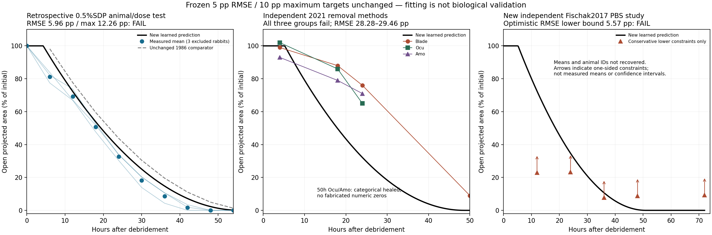

# Empirical corneal learner: actual calibration and rejected predictions

The user authorized data-driven models. This implements a **new optional offline
corneal component**, not a fitted replacement for the immutable vCornea cellular
model. It predicts projected open wound area from initial radius, elapsed time
and reported silk-derived-protein (SDP) concentration. It does not read later
observed areas, identify an inflammatory mechanism or model C-NAC treatment.

## Frozen experiment and actual execution

The [learning protocol1.0.0](learning-protocol-1.0.0.json), SHA256
`df8a95a48f8a43947720e0c7267f6b49a3ff7fc8d46fc0e58bb60a2d4ac7339b`,
was frozen before the first actual experimental fit. Exactly six actual rabbits
from Abdel-Naby et al.2017 ([original article](https://doi.org/10.1371/journal.pone.0188154))
are calibration animals: all three Control and all three2%SDP animals. Their60
rows include six baselines;54 nonbaseline values are fitted, not54 animals.
All three0.5%SDP animals and all30 of their observations are excluded from the
optimizer. This is a complete dose/animal split, not a timepoint-row split.
The dataset was previously inspected: **retrospective interpolation**, not a
blinded or newly independent-study test. Original raw area units remain unspecified;
only within-animal normalization is used. The published n4/actual n3 discrepancy
is preserved. [Original workbook and terms](../../../data/cornea-evidence-20261024/).

The four fitted parameters are two speeds and two delays, at0% and2%SDP. Each
endpoint has a fixed coarse grid and three fixed refinements, with54 equal-weight
animal/time residuals in normalized **area**. Speed is constrained to0–200µm/h,
lag to0–24h. Rates and delays interpolate linearly in concentration within0–2%.
There is one selected architecture, no architecture/hyperparameter search and no
test-driven refit. Circular projection and dose interpolation are assumptions.

The actual child completed with exit0 in0.2256s (parent0.5711s), below its60s wall
limit, with41,640 objective evaluations below the45,000 cap. macOS Seatbelt
denied network and writes outside the fresh folder. Actual attempted reads of
the heldout/raw/independent-study files returned PermissionError before training.
All predictions were generated in that child **before** parent-side evaluation.
The declared complete horizons were54h,50h and72h, sampled every0.25h.

Learned parameters: Control speed69.164µm/h, lag5.2135h;2%SDP speed64.204µm/h,
lag1.449h. These are fitted effective kinetics, **not measured cell velocities or
causal pharmacological constants**. The source/artifact/model/protocol/lock hashes
and denied-read probes are in the [actual receipt](observed-2026-10-24/child-execution.json).

## Results without changed criteria

The primary target was cohort-mean RMSE≤5 percentage points and maximum error≤10
points at **every**6,12,…,54h observation, plus≥0.5-point RMSE improvement over
the unchanged1986 kinetic comparator. Baseline equality is excluded from metrics.

| Comparison | Mean-area RMSE | Maximum absolute error | Outcome |
|---|---:|---:|---|
| Heldout2017 intermediate dose, unchanged1986 comparator |10.2604pp|17.0329pp|Comparator fails|
| Heldout2017 intermediate dose, new learned candidate |5.9583pp|12.2600pp|Improved by4.3021pp, **fails5/10 targets**|
| Independent2021 Blade |29.4554pp|43.8643pp|Fail|
| Independent2021 Ocu |28.2808pp|36.2677pp|Fail|
| Independent2021 Amo |28.3786pp|38.8643pp|Fail|

All three actual heldout-animal RMSE/max errors are retained:4.7356/9.5724,
8.6455/15.9824 and4.9364/11.2251pp. No failing animal/timepoint is removed.
2021's two categorical “Completely Healed” observations remain categorical;
all10 numeric means and published± fields are retained without invented n or CIs.
The learned Control kinetics transfer **worse** than the earlier1986 candidate.

The new independently sourced **Fischak2017 PBS**72h challenge also rejects this
candidate. Only graph-derived one-sided constraints are recovered, not numerical
cohort means. Even their deliberately optimistic RMSE lower bound is5.5674pp,
above the fixed5pp target; the corresponding maximum-error lower bound is9.2316pp.
**5.5674pp is a lower bound, not the actual study RMSE.** Original graph data may
imply larger errors. Training neither uses nor fits this study. Its72h horizon
also tests extrapolation beyond the54h calibration horizon.

All actual outputs, generated immutable models/plans, calibration, process record,
executed operator and comparisons are [retained here](observed-2026-10-24/).
The public model descriptors remain unvalidated and are not in the default
API/Worker catalog. The operator's observed exit2 means a completed scientific
comparison failed; its child exit0 records successful computation only.



## New independent evidence: what was and was not recovered

Fischak C et al.2017, *Effect of Topically Administered Chitosan-N-acetylcysteine
on Corneal Wound Healing in a Rabbit Model*,
[DOI10.1155/2017/5192924](https://pmc.ncbi.nlm.nih.gov/articles/PMC5485343/),
reports20 rabbits total,6mm nominal mechanical debridement, PBS50µL twice daily
and0/12/24/36/48/72h measurements. [Original PDF](fischak2017/article.pdf),
[JATS](fischak2017/article.xml), [original figure](fischak2017/original-figure1.jpg),
NCBI version metadata and [acquisition receipt](fischak2017/acquisition.json)
are retained with attribution and the original CC BY statement (version unspecified).
The source PDF's MD5 matches the NCBI OA version metadata; an HTML challenge
misnamed as PDF is retained privately as a failed acquisition, never analyzed.

PBS baseline projected fluorescein area is31.4±5.9mm², whereas OCT reports24.6±3.1mm².
The latter explicitly corrects corneal curvature; the measurements are not pooled.
The declared candidate radius is derived from the **reported mean baseline
fluorescein area**, `sqrt(31.4/pi)`mm; it is not fitted to later points or chosen
after prediction. The ratio of cohort means is distinct from the2017 workbook's
mean of within-animal ratios. Nominal6mm and measured baseline differ; supportive
care and injury/geometry equivalence are unresolved. No source± becomes a CI.

The figure has individual black polylines but no recoverable animal IDs/raw
table/per-arm count. Pixel traces overlap and cannot safely be assigned to
longitudinal animals. The [extraction protocol](fischak2017/extraction-protocol-1.0.0.json)
was frozen before extraction/candidate fitting. Original raster pixels are
extracted by Poppler, calibrated against PDF axis strokes and its image transform,
then inspected at **all five actually measured nonbaseline times**. There is no
fabricated60h observation. A fixed±0.5mm² digitization allowance and3-column band
merge ambiguous ink. Each disjoint cluster implies at least one different
measurement at that time. Summed lower areas divided by the **entire study20**
animals give a conservative lower bound on the PBS mean; all unseen/overlapping
curves contribute zero. No equal arm sizes or precise means are assumed.

[Derived constraints](fischak2017/constraints.json) are not raw observations,
animal records, confidence intervals or passing validation. This one-sided test
can reject a too-small prediction; otherwise it must remain indeterminate.

## Reproduce explicitly offline

```bash
uv run --frozen python scripts/extract_corneal_curve_constraints.py \
  --output .peykar/fischak-new-constraints.json
uv run --frozen python scripts/learn_corneal_front.py \
  --output .peykar/corneal-learned-front-new-run
```

Use fresh paths. The learning operator requires its reviewed macOS Seatbelt
isolation, all pinned source/input hashes, bounded evaluations and actual child
exit/artifact checks. It returns1 for child failure,2 for rejected comparison,
3 if independent evidence remains indeterminate. None grants biological approval.
Tests replay retained evidence and synthetic engineering fixtures; they do not
silently retrain this experimental candidate.

## Next scientific dependency

Do not tune this candidate on its now-consumed heldout group and relabel the
result independent. The [shared-front diagnostic](../shared-front-audit/README.md)
already shows that changing one common time-varying displacement cannot match the
2017/2021 cohort means under the declared nominal geometry. This is a limitation
of that deterministic shared-front hypothesis, not a universal bound on
stochastic/hierarchical models or proof of a specific biological cause.

The next useful corneal extension needs independent, measured baseline geometry,
injury/substrate/care covariates or matched longitudinal image/edge/migration data,
and another entire study reserved before any selection. Relevant cell-density/EGF
models have been screened in [the source notes](mechanism-screening.json); their
unresolved source/time-scale differences preclude silently transplanting them as
a known correction. Full vCornea publication reproduction and cellular/chemical/
barrier validation remain open. Retina/other-tissue reuse stays roadmap backlog.
