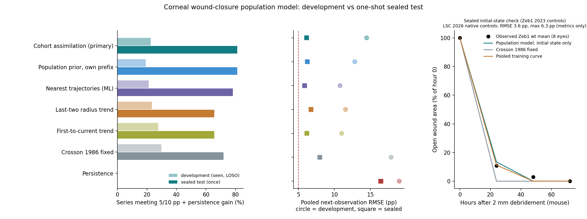
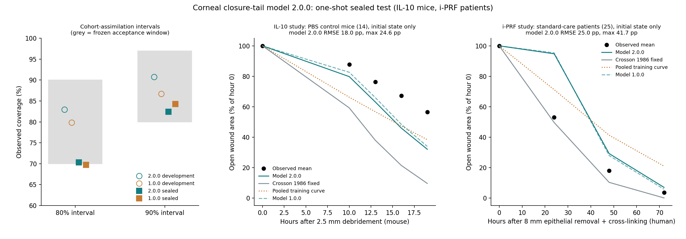

# Cross-study population model of corneal wound closure

Status: **development finished, protocol frozen and pushed (commit `de9762a0`),
sealed test run once on 2026-10-27.** The test result below was produced after
the freeze; nothing in the model, data or criteria was changed afterwards.

## Why a new approach

Every earlier candidate was a single-study rule tuned or checked on the same three
consumed rabbit studies (16 series). They could not say how much error to expect
in a new lab, because they had no model of between-study variation, no noise
model and no uncertainty. Their failures were informative: re-fitting the earlier
data shows migration speed is fairly conserved (≈60–90 µm/h in all rabbit
studies) while the latent phase varies from ≈1 to ≈17 h between studies.

This component therefore uses:

1. **Kinematics** — the projected radius shrinks at constant speed after a lag
   (Crosson 1986), so speed is in physical µm/h and transfers across wound sizes.
2. **Observation model** — Gaussian noise in √area with a study-level SD that is
   learned, not assumed; a reported area of 0 is censored below a 125 µm residual
   radius instead of being treated as an exact zero.
3. **Hierarchy** — animal within study within species/injury context, fitted by
   penalized REML on per-series grid posteriors. Predictions are distributions.
4. **Cohort assimilation (primary online method)** — at each measurement time all
   animals of the group measured so far update the group mean, the noise level and
   each animal's parameters together. Only values at or before that time are used.
5. **Comparators** — persistence, last-two radius trend, first-to-current trend,
   Crosson's fixed formula, a pooled empirical curve, and an instance-based
   machine-learning forecaster (k-nearest trajectories with time alignment).

Code: `peykar.model_learning.corneal_population`, `corneal_analog`,
`peykar.validation.cornea_population_evaluation`, `cornea_population_data`,
`cornea_population_sources`; operator `scripts/evaluate_corneal_population.py`.
Data and the outcome-blind search: [dataset README](../../../data/cornea-wound-population-2026-10-27/README.md).

## Development result (leave one study out, 5 studies, 47 series, 168 targets)

All development data were seen while building the model, so this is not an
independent test. Full tables: [development-loso-2026-10-27/tables.md](development-loso-2026-10-27/tables.md).

- No method meets the fixed 5/10 pp criterion in most development series. Even
  the best in-sample radius–lag fit of each complete series misses it for 3/9
  rabbits and 9/15 rats, so for those data the criterion is below the
  measurement floor.
- Cohort assimilation: 6.3 pp (2017 rabbits) and 6.5 pp (DIO mice), similar to
  the local trends on rabbits and better on mice, but 26 pp on the coarse rat
  study whose speed is far from every other species.
- Initial-state prediction of a held-out study fails for every method (pooled
  20–27 pp); Crosson's formula passes only the 2017 rabbits.

## Sealed test (2 independent mouse studies, 64 series, 152 targets)

[Primary analysis](sealed-test-2026-10-27/primary-analysis.json),
[tables](sealed-test-2026-10-27/tables.md),
[public report](sealed-test-2026-10-27/report-public.json) (CC BY-NC-ND study
reduced to metrics), [execution record](sealed-test-2026-10-27/execution-record.json).
Trained on all development studies; the mouse context had only one
development study (DIO mice, 2 mm wounds).

| Question (frozen criterion) | Result |
|---|---|
| U1: initial-state control-group mean, ≤5 pp RMSE and ≤10 pp max | **2/2 pass**: Zeb1 wt 2.26/2.83 pp; LSC native 3.60/6.34 pp. Crosson's formula fails both (6.4/10.7 and 18.9/32.1); pooled curve passes Zeb1 only |
| U2: series meeting 5/10 pp and ≥0.5 pp gain over persistence | cohort assimilation **52/64**; population prior 52/64; nearest trajectories 50/64; Crosson 46/64; last-two and first-to-current trends 42/64; persistence 0/64 |
| Primary comparison: cohort vs last-two trend, same 152 targets | **6.12 vs 6.73 pp RMSE** — cohort lower, as declared. Differences are small: nearest trajectories 5.86, first-to-current 6.17, population prior 6.24, Crosson 7.96, persistence 16.46 pp |
| Calibration of cohort intervals | 80% interval: 77.6% (within 70–90%, pass). 90% interval: **79.6% (below 80%, fail)** — intervals are slightly too narrow |
| Largest single miss | cohort 44.4 pp (Zeb1 het eye-7) vs 35.2 pp for last-two trend |



Failures of the primary method, all retained: 6/12 LSC native-control series
(two cannot be fitted within 5/10 pp even in-sample), Zeb1 wt eye-5, two Zeb1 het
eyes, one LSC treated series, and two Zeb1 wt eyes whose errors are small (≤3.8 pp)
but not 0.5 pp better than persistence because those wounds were already closed.

## What this does and does not show

- Within one species and a standard protocol (mouse, 2 mm central debridement),
  a population model trained on **one other lab's** study predicted two new labs'
  control-group curves within 5/10 pp from wound size alone. That is a scoped,
  independent predictive success, not universal validity.
- The same initial-state task failed for rabbits and rats in development: rabbit
  latent phases differ by up to ~10 h between labs, and the one rat study used a
  different whole-cornea injury with coarse measurements.
- Online forecasting gains are real but modest. The sealed studies are smoother,
  denser-in-time mouse data than the development set, so pass rates are not
  comparable across the two sets. Interval calibration is short of the frozen
  90% target.
- Not shown: treatment-effect prediction, cellular/chemical mechanism, stromal or
  nerve repair, human use, or any vCornea validation.

Reproduce the sealed run (requires the private custody records):

```bash
uv run --frozen python scripts/evaluate_corneal_population.py --sealed \
  --protocol experiments/vcornea/repair-front/population-model/protocol-1.0.0.json \
  --output .peykar/<fresh-dir>
```

The operator refuses to run if any pinned hash changed. A second run of an
unchanged sealed set is a replay, not a new test.

## Model 2.0.0: closure tail (frozen 2026-10-28, protocol 2.0.0)

**Why.** Every one of the 31 interval misses of the 1.0.0 sealed test was a
residual defect larger than the upper bound near closure: a constant-speed front
closes too abruptly. Model 2.0.0 lets the front slow down when the defect is
small, `dr/dt = −v·r/(r + r_c)` after the lag (`r_c = 0` is model 1.0.0). The
closed form uses the Lambert W function. One tail radius `r_c` per
species/injury context is chosen from {0, 100, 200, 300, 500, 800} µm by the
training series' marginal likelihood; everything else is unchanged
(`peykar.model_learning.corneal_population2`,
`peykar.validation.cornea_population_evaluation2`,
`scripts/evaluate_corneal_population2.py`).

**More data.** Dataset release 1.1.0 adds article-table studies (rabbit and rat
alkali burns, rat debridement under environmental insults, diabetic rats, human
PRK and epithelium-off cross-linking): 16 development studies and 147 series in
total. See the [dataset README](../../../data/cornea-wound-population-2026-10-27/README.md).

**Development result** (leave one study out, all 16 studies; development
reference only, [analysis](development-loso-2026-10-28/development-analysis.json),
[tables](development-loso-2026-10-28/tables.md)):

| | Model 2.0.0 | Model 1.0.0 (same data) |
|---|---|---|
| Cohort assimilation, pooled RMSE (293 targets) | **9.23 pp** | 10.27 pp |
| Cohort 80% / 90% interval coverage | **82.9% / 90.8%** | 79.9% / 86.7% |
| Zeb1 mice (consumed 1.0.0 sealed study) cohort coverage 80/90% | **84% / 84%** | 62% / 69% |
| Series passing 5/10 pp (cohort) | 57/104 | 62/104 |
| Nearest-trajectory forecaster, pooled RMSE (462 targets) | 9.87 pp | 9.87 pp |

- The tail mainly fixes calibration; accuracy gains are small, and the
  nearest-trajectory forecaster stays as accurate overall.
- Initial-state prediction (U1) still fails outside mouse debridement: rabbit
  groups 20–55 pp RMSE, rat and human groups 8–33 pp (the human, rat alkali and
  cautery contexts only through the all-context fallback). Only the Zeb1 and
  LSC mouse groups pass.
- The radius–lag kinematics cannot fit alkali-burn curves even in-sample (0/13
  series of three alkali studies within 5/10 pp). Alkali burns need a different
  model; they are not covered by this one.

**Sealed test 2.0.0.** Two studies no developer has read: the IL-10 mouse study
(55 per-mouse series; excluded in 1.0.0 because its deposit lacks the T0 row,
admitted under extraction protocol 1.1.1 by the custodian) and the i-PRF human
cross-linking study (two group means). Frozen hypotheses:
[protocol-2.0.0.json](protocol-2.0.0.json) — H1 cohort calibration (90% interval
in [0.80, 0.97] and 80% in [0.70, 0.90]), H2 cohort RMSE below the last-two
trend, H3 2.0.0 versus 1.0.0, H4 initial state per control group.

### Sealed result 2.0.0 (run once on 2026-10-28, after commit `2cee1b01`)

[Primary analysis](sealed-test-2026-10-28/primary-analysis.json),
[tables](sealed-test-2026-10-28/tables.md),
[public report](sealed-test-2026-10-28/report-public.json),
[execution record](sealed-test-2026-10-28/execution-record.json). Both sealed
studies are CC BY 4.0; their records are now published as consumed data under
[`consumed-sealed/`](../../../data/cornea-wound-population-2026-10-27/consumed-sealed/README.md).

| Frozen question | Model 2.0.0 | Model 1.0.0, same data |
|---|---|---|
| H1 cohort 80% / 90% coverage (165 IL-10 targets) | **70.3% / 82.4%: pass** (80% by one target) | 69.7% / 84.2%: 80% window missed |
| H2 cohort vs last-two trend, pooled RMSE | **13.10 vs 16.27 pp: pass** | 13.01 pp |
| Series meeting 5/10 pp (cohort) | 3/55 | 4/55 |
| H4 IL-10 PBS controls, initial state | 18.0 / 24.6 pp: fail | 15.8 / 22.7 pp |
| H4 i-PRF standard-care patients, initial state | 25.0 / 41.7 pp: fail | 25.1 / 42.3 pp |



- The closure tail did what it was built for on new data: cohort intervals are
  calibrated within both frozen windows, where 1.0.0 missed one. The margin is
  small, so this is evidence, not proof, of better calibration.
- Accuracy did not improve: 2.0.0 and 1.0.0 are within 0.1 pp. On IL-10 the
  individual population prior (11.4 pp) beat cohort assimilation (13.1 pp); the
  nearest-trajectory forecaster gave 13.1 pp. IL-10 measurements 3 h apart are
  noisy: the best possible in-sample fit meets 5/10 pp in only 30/55 series.
- Initial-state transfer failed in both new studies. The IL-10 PBS mice healed
  more slowly in the first 19 h than the 2 mm mouse studies implied. The i-PRF
  patients healed faster than the only similar training study (4 insulin-trial
  controls); Crosson's fixed rabbit kinematics came closest (5.3 / 7.7 pp).
- For i-PRF group means, next-observation errors were small for all prefix-based
  methods (2.5–3.2 pp) and large for persistence (24.8 pp).
